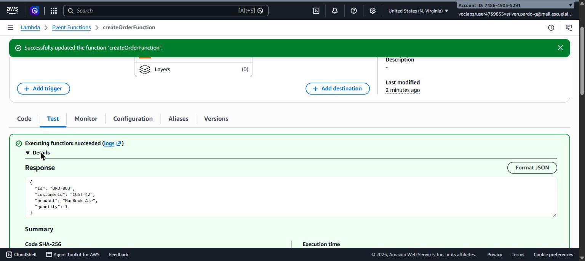
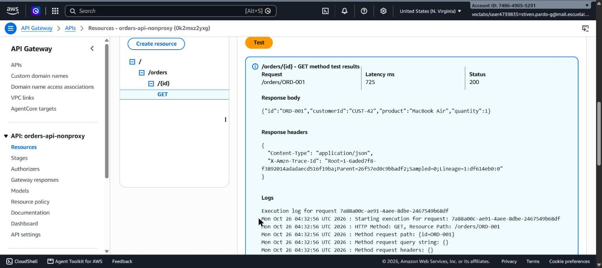
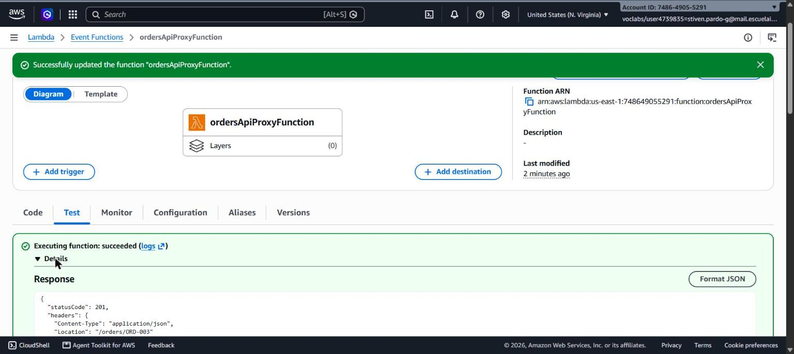
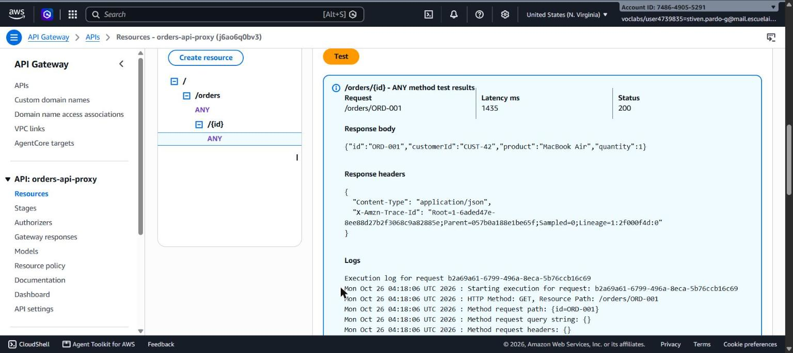
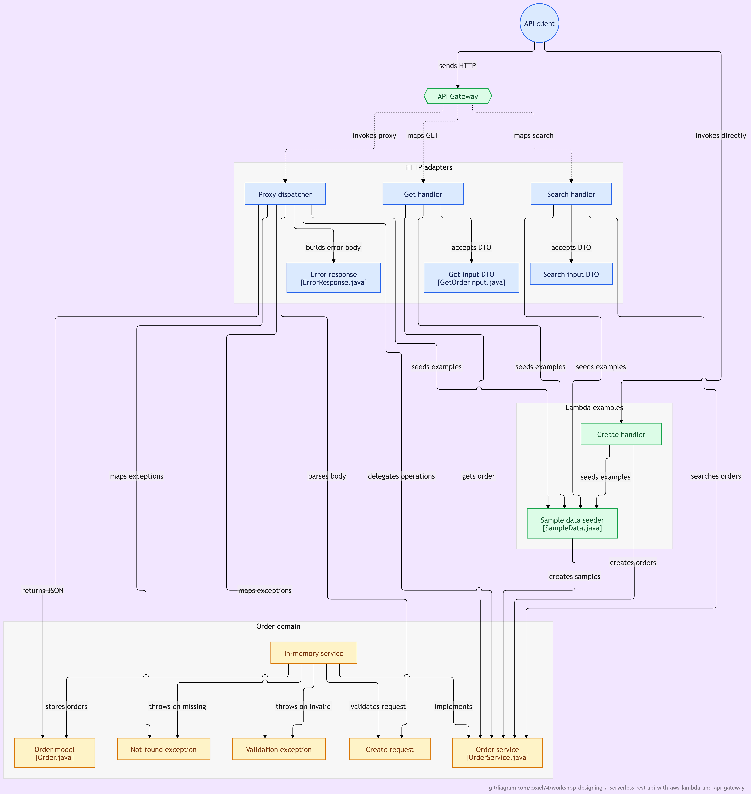

# Workshop: Designing a Serverless REST API with AWS Lambda and API Gateway

**Author:** Stiven Esneider Pardo Gutiérrez

A small Order Management REST API built with Java 17, Maven, AWS Lambda
and Amazon API Gateway, exploring two different ways of connecting an
HTTP API to serverless functions: a custom (non-proxy) integration with
mapping templates, and a Lambda proxy integration with a thin HTTP
adapter written in Java.

All source code lives under [`orders-api/`](orders-api).

---

## 1. API design

### Resources

| Operation | HTTP request |
|---|---|
| Create an order | `POST /orders` |
| Retrieve an order | `GET /orders/{id}` |
| Find orders belonging to a customer | `GET /orders?customerId={customerId}` |
| Delete an order | `DELETE /orders/{id}` |

The API has a single resource collection, **orders**, represented by
`/orders`, plus the individual-item resource `/orders/{id}`.

**Why `/orders/{id}` to retrieve a particular order?**
An order has a unique identifier, so it is a single, addressable
resource inside the `orders` collection. REST convention places the
identifier of a specific resource instance in the URL path, not in the
query string, because the path segment *is* the resource's address —
it can be bookmarked, cached by intermediaries, and reused directly by
`DELETE` on the same URL.

**Why is `customerId` a query parameter in the search operation?**
Searching "orders belonging to a customer" is a *filter* applied to the
`orders` collection, not the address of one resource — a given
`customerId` can match zero, one, or many orders. REST convention
reserves query parameters for this kind of optional, collection-level
filtering, while keeping the canonical collection URL (`/orders`)
intact.

**What should `POST /orders` return when an order is created
successfully?**
`201 Created`, with the full representation of the new order
(including its generated `id`) as the response body, and a `Location`
header pointing to `/orders/{id}` so the client can immediately address
the new resource.

**What should the API return when an order does not exist?**
`404 Not Found`, with a JSON error body describing the problem.

**What information should an error response contain?**
A stable, machine-readable `error` code and a human-readable `message`:

```json
{
  "error": "ORDER_NOT_FOUND",
  "message": "Order ORD-999 does not exist"
}
```

---

## 2. Part I — Plain Java application

The application logic lives entirely under
[`orders-api/src/main/java/com/stivenpardo/ordersapi/domain`](orders-api/src/main/java/com/stivenpardo/ordersapi/domain)
and has **no dependency on HTTP, AWS Lambda, API Gateway classes, Spring
Boot, or a web server**:

- `Order`, `CreateOrderRequest` — plain data classes.
- `OrderNotFoundException`, `InvalidOrderRequestException` — plain
  `RuntimeException`s with no HTTP concept attached.
- `OrderService` — the contract (`createOrder`, `getOrder`,
  `getOrdersByCustomer`, `deleteOrder`).
- `InMemoryOrderService` — the implementation, backed by a
  `ConcurrentHashMap`. Because AWS Lambda execution environments are
  ephemeral, this in-memory collection is explicitly **not** treated as
  durable storage.

### Checkpoint 1

- **Can the application functionality be tested without AWS?** Yes —
  [`InMemoryOrderServiceTest`](orders-api/src/test/java/com/stivenpardo/ordersapi/InMemoryOrderServiceTest.java)
  runs with plain JUnit 5, no AWS SDK and no deployed infrastructure.
- **Does your application require a web server?** No.
- **Does it require Spring Boot?** No.
- **What does the generated JAR contain?** `mvn package` produces two
  jars: `orders-api.jar`, containing only this project's compiled
  classes, and `orders-api-1.0.0-aws.jar` (built by the shade plugin),
  which additionally bundles every runtime dependency
  (`aws-lambda-java-core`, `aws-lambda-java-events`, Jackson) so it can
  run standalone inside the Lambda execution environment. The second
  jar is the one uploaded to AWS Lambda.
- **Which parts of your application currently know about HTTP?** None,
  at this stage. HTTP awareness is introduced later, exclusively inside
  the `lambda` package.

### Running the tests

```bash
cd orders-api
mvn test       # 15 tests: 8 for the domain service, 7 for the HTTP adapter
mvn package     # generates target/orders-api-1.0.0-aws.jar
```

---

## 3. Part II — A single operation on AWS Lambda

[`CreateOrderLambdaHandler`](orders-api/src/main/java/com/stivenpardo/ordersapi/lambda/CreateOrderLambdaHandler.java)
implements `RequestHandler<CreateOrderRequest, Order>` and was deployed
directly to AWS Lambda, with no API Gateway in front of it, to observe
how the runtime converts JSON into Java objects.

### Investigation: how does the AWS Lambda Java runtime convert JSON into Java objects?

The `aws-lambda-java-core` runtime inspects the generic type parameters
of `RequestHandler<I, O>`. When the input/output types are plain POJOs
(rather than a raw `String`, `InputStream`, or one of the predefined
AWS event types), the runtime uses an internal Jackson `ObjectMapper`
to deserialize the incoming JSON event straight into an instance of
`I` via its public no-argument constructor and standard JavaBean
getters/setters — and serializes the value returned by `handleRequest`
back into JSON the same way. No manual parsing code is required in the
handler.

This was verified against the deployed `createOrderFunction` with two
different inputs:

**Input 1**

```json
{"customerId": "CUST-42", "product": "MacBook Air", "quantity": 1}
```

**Response**

```json
{"id":"ORD-003","customerId":"CUST-42","product":"MacBook Air","quantity":1}
```

**Input 2**

```json
{"customerId": "CUST-100", "product": "Mechanical Keyboard", "quantity": 3}
```

**Response**

```json
{"id":"ORD-004","customerId":"CUST-100","product":"Mechanical Keyboard","quantity":3}
```




The field names in the JSON mapped exactly onto `CreateOrderRequest`'s
properties with no hardcoded parsing, and the returned `Order` was
serialized back with all four fields — confirming the mapping is driven
by reflection over the POJO, not by anything specific to this handler.

### Checkpoint 2

```
JSON
  |
  v
AWS Lambda Runtime  (Jackson-based, reflection over the handler's generic types)
  |
  v
CreateOrderRequest (Java object)
  |
  v
OrderService.createOrder(...)   <- plain Java, no AWS types
  |
  v
Order (Java object)
  |
  v
JSON
```

---

## 4. Part III/IV — API Gateway mapping template (non-proxy integration)

`GET /orders/{id}` was deployed as a **non-proxy / custom** Lambda
integration on a dedicated REST API
(`orders-api-nonproxy`, id `0k2mxz2yxg`), backed by
[`GetOrderHandler`](orders-api/src/main/java/com/stivenpardo/ordersapi/lambda/GetOrderHandler.java),
which takes a tiny `GetOrderInput { id }` DTO — it never sees the raw
HTTP request.

**Integration request mapping template** (`application/json`):

```velocity
{"id": "$input.params('id')"}
```

API Gateway extracts the `{id}` path parameter and builds this JSON
document before invoking the Lambda function.

**Error mapping.** `GetOrderHandler` lets
`OrderNotFoundException` propagate; the Lambda runtime turns that into
an error payload containing `errorMessage`. The integration response
for this method matches that message with the selection pattern
`.*does not exist.*`, maps it to HTTP `404`, and reshapes the body with
its own mapping template:

```velocity
{"error": "ORDER_NOT_FOUND", "message": "$input.path('$.errorMessage')"}
```

### Verified behaviour

```
GET /orders/ORD-001  -> 200 OK
{"id":"ORD-001","customerId":"CUST-42","product":"MacBook Air","quantity":1}

GET /orders/ORD-999  -> 404 Not Found
{"error": "ORDER_NOT_FOUND", "message": "Order ORD-999 does not exist"}
```



Full request/response transcripts: [`orders-api/docs/example-requests-nonproxy.md`](orders-api/docs/example-requests-nonproxy.md).

### Checkpoint 3 — what is API Gateway responsible for here?

In this architecture, API Gateway owns:

- **Routing** — matching `GET /orders/{id}` to this specific method.
- **Path parameter extraction** — reading `{id}` from the URL.
- **Request transformation** — building the exact JSON the Lambda
  expects, via a Velocity (VTL) mapping template.
- **Response/error interpretation** — matching the Lambda's
  `errorMessage` against a regular expression to pick a status code.
- **Response transformation** — reshaping the error payload into the
  project's error JSON format.
- **Declaring status codes up front** — `200` and `404` are configured
  as method responses before any request is ever made.

**Advantages:** the Lambda handler stays extremely small and has zero
HTTP awareness; the HTTP contract is visible and centrally managed in
API Gateway.

**Disadvantages:** that contract now lives in Velocity templates
embedded in AWS configuration rather than in version-controlled,
compiler-checked Java; it cannot be unit tested, only exercised by
deploying and calling the API Gateway console test feature or `curl`;
and matching on free-text exception messages (`.*does not exist.*`) is
fragile — renaming the exception's message would silently break the
HTTP mapping without any compiler warning.

---

## 5. Part V — Lambda proxy integration

`POST /orders`, `GET /orders/{id}`, `GET /orders?customerId=`, and
`DELETE /orders/{id}` were deployed on a second REST API
(`orders-api-proxy`, id `j6ao6q0bv3`) using **Lambda proxy
integration**: a single `ANY` method on `/orders` and `/orders/{id}`,
both wired to the same function,
[`ordersApiProxyFunction`](orders-api/src/main/java/com/stivenpardo/ordersapi/lambda/OrdersApiProxyHandler.java).

An example of the raw event API Gateway sends to Lambda in proxy mode
is saved at
[`orders-api/docs/example-apigateway-proxy-event.json`](orders-api/docs/example-apigateway-proxy-event.json).
The relevant fields are:

| Information | Where it appears |
|---|---|
| HTTP method | `httpMethod` |
| Path | `path` |
| Path parameters | `pathParameters` (e.g. `{"id": "ORD-001"}`) |
| Query parameters | `queryStringParameters` |
| Headers | `headers` / `multiValueHeaders` |
| Request body | `body` (a string, not pre-parsed) |

### The HTTP adapter

`OrdersApiProxyHandler` is the **only** class in the project that
imports `APIGatewayProxyRequestEvent`/`ResponseEvent`, builds HTTP
headers, or chooses status codes:

```
API Gateway
      |
      v
OrdersApiProxyHandler   <- knows about AWS events, HTTP status codes, headers, JSON (de)serialization
      |
      v
OrderService             <- ordinary Java: Order, Customer, Product, Quantity
```

It extracts `httpMethod`, `pathParameters`, `queryStringParameters` and
`body`, delegates to `OrderService`, and translates the result (or a
thrown `OrderNotFoundException` / `InvalidOrderRequestException`) into
an `APIGatewayProxyResponseEvent` with the correct status code, a
`Location` header on creation, and the project's JSON error shape on
failure.

Because the whole HTTP contract is expressed as plain Java objects,
it can be — and is — unit tested with JUnit, with no AWS deployment
required: see
[`OrdersApiProxyHandlerTest`](orders-api/src/test/java/com/stivenpardo/ordersapi/OrdersApiProxyHandlerTest.java)
(7 tests covering 201/200/404/400/204).

### Verified behaviour against the deployed API

Base URL: `https://j6ao6q0bv3.execute-api.us-east-1.amazonaws.com/prod`

| Request | Status | Body |
|---|---|---|
| `POST /orders` `{"customerId":"CUST-42","product":"MacBook Air","quantity":1}` | **201 Created** (`Location: /orders/ORD-003`) | `{"id":"ORD-003","customerId":"CUST-42","product":"MacBook Air","quantity":1}` |
| `GET /orders/ORD-001` | **200 OK** | `{"id":"ORD-001","customerId":"CUST-42","product":"MacBook Air","quantity":1}` |
| `GET /orders/ORD-999` | **404 Not Found** | `{"error":"ORDER_NOT_FOUND","message":"Order ORD-999 does not exist"}` |
| `GET /orders?customerId=CUST-42` | **200 OK** | `[{"id":"ORD-001",...},{"id":"ORD-003",...}]` |
| `POST /orders` with `"quantity": 0` | **400 Bad Request** | `{"error":"INVALID_ORDER_REQUEST","message":"quantity must be greater than zero"}` |
| `DELETE /orders/ORD-002` | **204 No Content** | *(empty)* |
| `DELETE /orders/ORD-999` | **404 Not Found** | `{"error":"ORDER_NOT_FOUND","message":"Order ORD-999 does not exist"}` |




Full transcripts: [`orders-api/docs/example-requests-proxy.md`](orders-api/docs/example-requests-proxy.md).

**Unexpected internal errors.** Any exception other than
`OrderNotFoundException`/`InvalidOrderRequestException` is caught by a
final `catch (Exception e)` block in `OrdersApiProxyHandler` and turned
into `500 Internal Server Error` with
`{"error":"INTERNAL_ERROR","message":"An unexpected error occurred"}`,
so the client never sees a raw stack trace.

---

## 6. Comparing the two architectures

| Question | Architecture A (non-proxy, mapping templates) | Architecture B (Lambda proxy) |
|---|---|---|
| More API Gateway configuration? | **Yes** — a resource, a method, an integration request template, method responses, and a separate integration response + template *per error case*, repeated for every operation. | No — one `ANY` method per resource reused by every HTTP verb. |
| More Java infrastructure code? | No — handlers are a few lines (`GetOrderHandler` just calls the service). | **Yes** — `OrdersApiProxyHandler` owns routing, parameter extraction, serialization and status-code logic (~140 lines). |
| Easier to test locally? | No — the VTL templates can only be exercised by deploying and calling API Gateway's console Test tool or `curl`; there is no local VTL interpreter in this project. | **Yes** — the entire HTTP contract is plain Java, exercised directly by JUnit (`OrdersApiProxyHandlerTest`), no deployment needed. |
| Where are HTTP status codes defined? | Inside API Gateway configuration (method responses + Lambda error regex). | Inside Java code (`OrdersApiProxyHandler` returning `statusCode`). |
| What happens going from 3 to 30 operations? | Configuration grows **linearly and by hand**, for every operation × every status code; it lives outside version control unless separately exported, and is easy to get subtly wrong (this project needed several console round-trips to get a single mapping template right). | 30 routes become 30 branches in one typed, compiler-checked, unit-tested Java class; API Gateway configuration barely changes. |
| Cleaner Java business logic? | `OrderService`/`InMemoryOrderService` are identical in both architectures — that boundary never moves. The difference is only in the adapter layer. | Same observation. |
| Easier for another developer to understand? | Requires reading two different languages in two different places: the Java handler *and* the Velocity templates buried in the AWS console (or an exported OpenAPI file). | A single Java class can be read top to bottom to see the whole contract. |
| Which would be chosen for a larger system? | — | **Lambda proxy integration**, with a small routing layer inside Lambda. All HTTP-relevant decisions — status codes, error shapes, validation triggers — stay in version-controlled, type-checked, testable Java instead of AWS configuration that is awkward to diff, review, and test at scale. |

---

## 7. Design decisions and alternatives considered

Three non-trivial decisions made while building this project, the
reasoning behind each, and what was ultimately implemented.

### 7.1 One Lambda per operation vs. one Lambda for the whole API

**Decision:** both styles were built, specifically to compare them —
Part III/IV uses small, per-operation Lambda functions
(`getOrderFunction` for `GET /orders/{id}`, with the same pattern
available for the search and create operations); Part V uses a single
`ordersApiProxyFunction` handling all four HTTP operations through
internal routing.

**Reasoning:** the workshop's own goal is to let the trade-off be
*observed* rather than assumed, so implementing only one style would
have defeated the purpose.

**Do I agree?** For the non-proxy style, yes — a dedicated function per
operation keeps each Lambda's responsibility and cold-start payload
minimal, and maps naturally onto one-resource-one-template API
Gateway configuration. For a growing proxy-style API, no — one Lambda
per route would multiply the deployment and permission-granting work
(each function needs its own resource-based policy entry) without
adding any real isolation, since the shared `OrderService` state lives
in the same process space regardless.

**Alternative considered:** per-operation Lambdas using *proxy*
integration (still small handlers, more deployable units), or a single
Lambda using *non-proxy* integration (would require one shared,
operation-agnostic mapping template, awkward to express in VTL).

### 7.2 Where validation lives

**Decision:** all validation (blank `customerId`/`product`,
non-positive `quantity`) lives inside
`InMemoryOrderService.createOrder`, not in any Lambda handler and not
in API Gateway.

**Reasoning:** "a quantity must be positive" is a business rule, not a
transport concern — it must hold true regardless of whether the call
arrives through a JUnit test, a direct Lambda invocation (Part II), or
either API Gateway architecture.

**Do I agree?** Yes. API Gateway request validators (JSON Schema
models) were considered and rejected, because they would duplicate the
same rule in two places — a schema and the Java code — which could
silently drift apart.

**Alternative:** API Gateway request validators; or validating inside
the Lambda handler layer instead of the domain service.

**What was implemented:** a single source of truth in
`InMemoryOrderService`, surfaced as `InvalidOrderRequestException`,
translated into `400 Bad Request` by whichever adapter happens to be
in front of it.

### 7.3 Exception design and error-handling strategy

**Decision:** domain exceptions
(`OrderNotFoundException`, `InvalidOrderRequestException`) carry no
HTTP concept whatsoever — the adapter layer alone decides the status
code.

**Reasoning:** this keeps the exceptions reusable across transports.
The non-proxy Lambdas simply let the exception propagate and rely on
API Gateway's regex-based error mapping; the proxy handler catches the
same exception types directly in Java and picks the status code
explicitly.

**Do I agree?** Mostly, with one caveat discovered while building Part
III/IV: the non-proxy architecture's `.*does not exist.*` selection
pattern matches the exception's *message text*, not a stable code —
rewording the message would silently break the HTTP mapping with no
compiler warning. The proxy handler does not have this problem, since
it switches on the exception's *type*.

**Alternative:** give exceptions an explicit, stable error-code field
and have API Gateway's integration response match on that code instead
of free text; or skip non-proxy error mapping altogether.

**What was implemented:** the message-matching approach specified by
the workshop, kept as-is in Part III/IV to demonstrate the mechanism —
but the fragility above is a concrete, first-hand reason this project
ultimately prefers the proxy handler's type-based `catch` blocks for
anything beyond a learning exercise.

---

## 8. `DELETE /orders/{id}` — prediction vs. outcome

**Prediction, written before implementing the feature:**

- *Which Java classes should change?* `OrderService` needs a new
  `deleteOrder(String id)` method; `InMemoryOrderService` needs the
  implementation; `OrdersApiProxyHandler` needs a new branch for the
  `DELETE` HTTP method.
- *Do I need a new Lambda function?* No — for the proxy architecture,
  the existing `ordersApiProxyFunction` already receives every HTTP
  method through its `ANY` integration; a new function would only be
  required for the per-operation, non-proxy style.
- *Does API Gateway configuration need to change?* For the proxy
  architecture, no new resource or method is required — `DELETE` is
  already covered by the `ANY` method on `/orders/{id}`. For the
  non-proxy style, a brand-new `DELETE` method with its own mapping
  template would be needed.
- *Where should the deletion logic reside?* Inside `OrderService`, next
  to `createOrder`/`getOrder`, not inside any Lambda handler.
- *Where should the decision to return 204 vs. 404 reside?* In the HTTP
  adapter (`OrdersApiProxyHandler`), by catching
  `OrderNotFoundException` the same way `GET` already does.
- *Which tests should be added?* A JUnit test for
  `InMemoryOrderService.deleteOrder` (existing order removed, missing
  order throws `OrderNotFoundException`), plus two tests on the proxy
  handler (`204` for an existing order, `404` for a missing one).

**What was actually implemented** matches this prediction exactly:
`deleteOrder(String id)` was added to `OrderService`/
`InMemoryOrderService`, throwing `OrderNotFoundException` when the id
is unknown; `OrdersApiProxyHandler.handleDelete()` reuses the same
`catch (OrderNotFoundException e)` block already written for `GET`, so
no new Lambda function and no API Gateway change were needed beyond the
`ANY` method that was already deployed. Four new JUnit tests were
added:
`deletesAnExistingOrder`, `throwsWhenDeletingAnOrderThatDoesNotExist`
(`InMemoryOrderServiceTest`), and
`deletesAnExistingOrderAndReturns204`,
`returns404WhenDeletingAnOrderThatDoesNotExist`
(`OrdersApiProxyHandlerTest`). The only step beyond the original
prediction was verifying the behaviour against the *live, deployed*
API with `curl` (`204` then `404`), in addition to the local unit
tests.

---

## 9. Final API

```
POST    /orders
GET     /orders/{id}
GET     /orders?customerId={customerId}
DELETE  /orders/{id}
```

Status codes in use: `200 OK`, `201 Created`, `204 No Content`,
`400 Bad Request`, `404 Not Found`, and `500 Internal Server Error` for
any unexpected failure.

### Architecture diagram

The diagram below maps every class in the project onto the request
flow: the API client, API Gateway, the HTTP adapters (proxy dispatcher,
get/search/create handlers and their DTOs), and the Order domain layer
at the bottom (`OrderService`, `Order`, the two domain exceptions).



A simplified version of the same flow, for the proxy integration
specifically:

```mermaid
flowchart TD
    Client[Client<br/>curl / Postman]

    subgraph AWS["AWS-managed"]
        APIGW[Amazon API Gateway<br/>routing, parameter extraction,<br/>mapping templates]
        Lambda[AWS Lambda runtime<br/>JSON &lt;-&gt; Java object conversion]
    end

    subgraph JavaApp["Plain Java (no AWS types)"]
        Adapter[OrdersApiProxyHandler<br/>HTTP adapter: status codes,<br/>headers, (de)serialization]
        Service[OrderService /<br/>InMemoryOrderService<br/>business logic]
    end

    Client -->|HTTP request| APIGW
    APIGW -->|invoke| Lambda
    Lambda -->|APIGatewayProxyRequestEvent| Adapter
    Adapter -->|Order, CreateOrderRequest| Service
    Service -->|Order / exception| Adapter
    Adapter -->|APIGatewayProxyResponseEvent| Lambda
    Lambda -->|JSON| APIGW
    APIGW -->|HTTP response| Client
```

Only `APIGW`, `Lambda`, and the AWS event classes imported by
`OrdersApiProxyHandler` depend on AWS. `OrderService`,
`InMemoryOrderService`, `Order`, `CreateOrderRequest`, and both domain
exceptions are ordinary Java with zero AWS imports — this is also
exactly what the 15 JUnit tests exercise without any AWS credentials or
deployment.

---

## 10. The main question, applied

Throughout this project, every new piece of behaviour was assigned to
exactly one of three places by asking "where should this
responsibility live?":

| Responsibility | Where it lives | Why |
|---|---|---|
| Is `quantity > 0`? | Application logic (`InMemoryOrderService`) | A business rule, independent of transport. |
| Extracting `{id}` from the URL | API Gateway responsibility (both architectures) | Parsing the HTTP request is not the application's concern. |
| Choosing `404` vs `200` | Non-proxy: API Gateway (regex on error message). Proxy: HTTP adapter (`catch` block). | Varies by architecture — see section 6 for why the proxy approach was ultimately preferred. |
| Building the `Order` JSON response | Non-proxy: Lambda runtime (automatic). Proxy: `OrdersApiProxyHandler` via Jackson. | Serialization is an HTTP/adapter concern, never leaked into `OrderService`. |
| Generating the next order id | Application logic (`InMemoryOrderService`) | Entirely a business/domain concept. |

---

## 11. Build and test instructions

```bash
cd orders-api
mvn test        # runs all 15 JUnit tests
mvn package      # produces target/orders-api-1.0.0-aws.jar (the Lambda deployment package)
```

To redeploy a handler to AWS Lambda: upload
`target/orders-api-1.0.0-aws.jar` as the function code and set the
handler to the fully-qualified class name, for example:

```
com.stivenpardo.ordersapi.lambda.OrdersApiProxyHandler::handleRequest
```

---

## 12. Repository layout

```
Workshop-Designing-a-Serverless-REST-API-with-AWS-Lambda-and-API-Gateway/
├── README.md
└── orders-api/
    ├── pom.xml
    ├── docs/
    │   ├── screenshots/
    │   ├── example-apigateway-proxy-event.json
    │   ├── example-requests-proxy.md
    │   └── example-requests-nonproxy.md
    └── src/
        ├── main/java/com/stivenpardo/ordersapi/
        │   ├── domain/     (plain Java — no AWS dependency)
        │   └── lambda/     (AWS Lambda handlers + the HTTP adapter)
        └── test/java/com/stivenpardo/ordersapi/
```

---

## 13. Deployed resources (AWS Academy Learner Lab)

| Resource | Identifier |
|---|---|
| Lambda — Part II | `createOrderFunction` |
| Lambda — Part III/IV | `getOrderFunction` |
| Lambda — Part V | `ordersApiProxyFunction` |
| API Gateway — non-proxy | `orders-api-nonproxy` (`0k2mxz2yxg`), stage `prod` |
| API Gateway — proxy | `orders-api-proxy` (`j6ao6q0bv3`), stage `prod` |

These were deployed to an AWS Academy Learner Lab account; because Lab
sessions and credentials are temporary, the endpoints above may no
longer be reachable after the lab session ends. The request/response
evidence captured in `orders-api/docs/` and the screenshots embedded in
this README document their verified behaviour while live.
